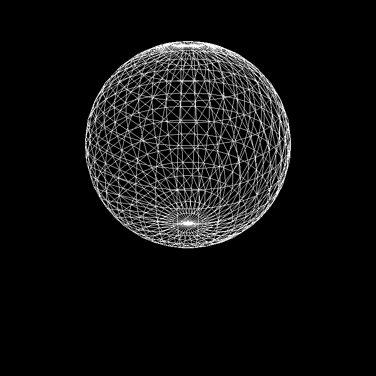

# Computer graphics assignments

A collection of University of Crete graphics coursework covering procedural meshes, transformations, lighting, skeletal animation, Maya scene authoring, and a Unity runner-game build.

**Python · NumPy · OpenGL / GLSL · Elements ECS scene graph · ImGui · Maya · Unity**

| Assignment | Work | Explore |
| --- | --- | --- |
| 1 | Sphere generation, geometric primitives, interactive transforms | [Code and screenshots](assignments/01) |
| 2 | Blinn–Phong materials, two-light scene, texture and skybox setup | [Code and screenshots](assignments/02) |
| 3 | Weighted joint transforms, keyframe animation, Maya scene | [Code and screenshots](assignments/03) |
| 4 | Packaged Unity runner game for Windows | [Download and run](assignments/04) |

<table><tr><td width="50%"><a href="docs/images/2.1.png"></a></td><td width="50%"><a href="docs/images/3.1.png"></a></td></tr></table>

*Actual framebuffer captures from the Python lighting and joint-animation exercises, rendered with Mesa software OpenGL. These show the scene before GUI overlays.*

## Run and explore

Start with the [step-by-step PC guide](docs/SETUP.md). It covers Python installation, the pinned Elements framework, all six exercise commands, GUI controls, opening the Maya scene, and launching the Windows game. A central launcher runs the original exercise files and loads the supplied assignment-2 shader extension without modifying your Elements installation.

```sh
python tools/run.py 1.1
python tools/run.py 2.1
python tools/run.py 3.1
```

These commands require the setup guide's Python environment and `vendor/Elements` checkout. The desktop apps open native OpenGL windows, rather than a browser recreation.

[Technical brief report](docs/report.pdf) · [Overleaf source ZIP](docs/report-overleaf.zip)

## Geometry and transformations



*Exercise 1.1: an indexed sphere in wireframe. Additional sphere variants remain commented out in the submission. [Assignment 1](assignments/01) also includes interactive object/group transforms and point/line/triangle primitives.*

## Materials and animation

The lighting controls vary material colors, light properties, and shininess. The animation exercise blends three joint matrices with per-vertex weights and interpolates two angle keyframes. Each assignment README links directly to the relevant implementation and captures.

All six Python entry points rendered through a 60-frame capture run on Linux with Python 3.10 and OpenGL 4.5 via llvmpipe. The Earth example retains an unresolved texture result, described in [Assignment 2](assignments/02). Maya and the Unity Windows game were not executed here. The archives contain a Maya binary scene and a runnable game build, but no editable Unity project. The separately linked solar-system project is not included.

Python source identifies Dimitrios Asimakopoulos, csd4845. The low-level graphics exercises build on the [Elements teaching framework](https://github.com/papagiannakis/Elements) by George Papagiannakis and contributors. Framework code and assets retain their upstream terms and are obtained separately.
