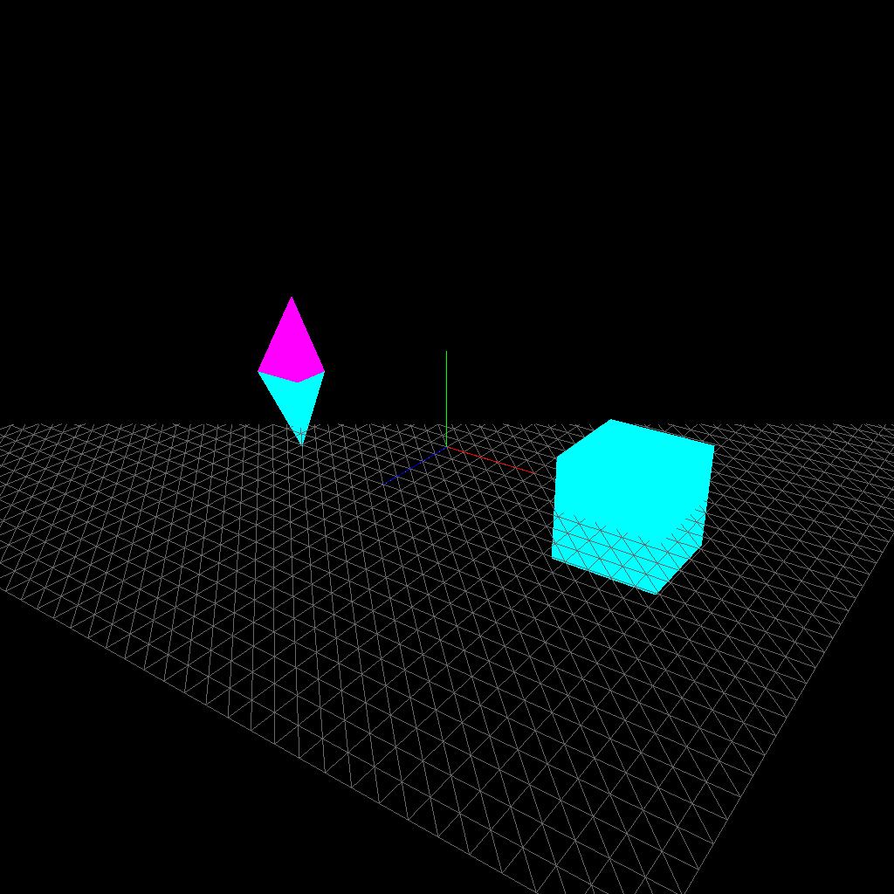
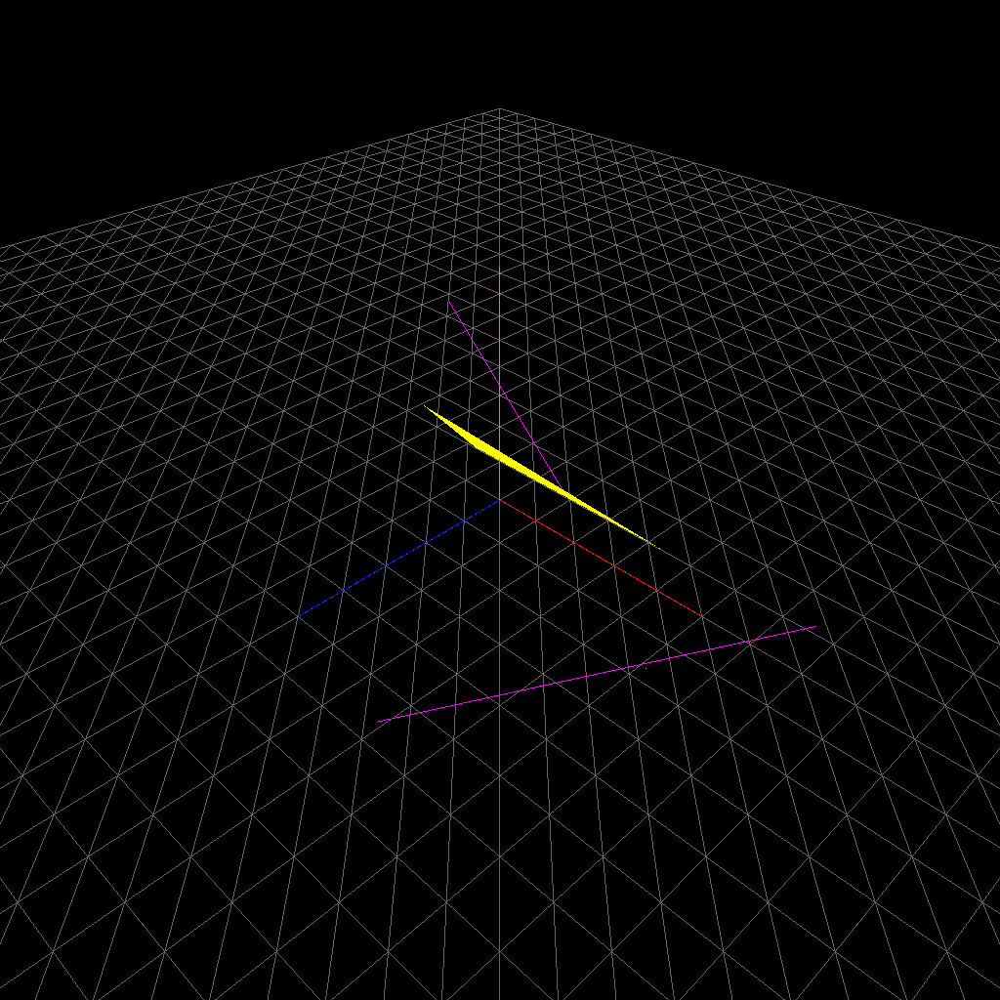

# Geometry and transformations

Procedural sphere vertices and triangle indices, vertex colors, object/group transforms, and separate triangle/line/point primitives.

**Python · NumPy · OpenGL · Elements · ImGui**


*Exercise 1.1: actual software OpenGL framebuffer capture from the supplied Python code, before GUI overlays.*



*Exercise 1.2: actual software OpenGL framebuffer capture from the supplied Python code, before GUI overlays.*



*Exercise 1.3: actual software OpenGL framebuffer capture from the supplied Python code, before GUI overlays.*

From the repository root, after completing the [PC setup guide](../../docs/SETUP.md):

```sh
python tools/run.py 1.1
python tools/run.py 1.2
python tools/run.py 1.3
```

Exercise 1.1 currently renders one wireframe sphere. Its additional sphere variants are commented out. Exercise 1.2 exposes translation, rotation, scale, and visibility through **TRS Controls**.

[Collection overview](../../README.md) · [Detailed run guide](../../docs/SETUP.md)
