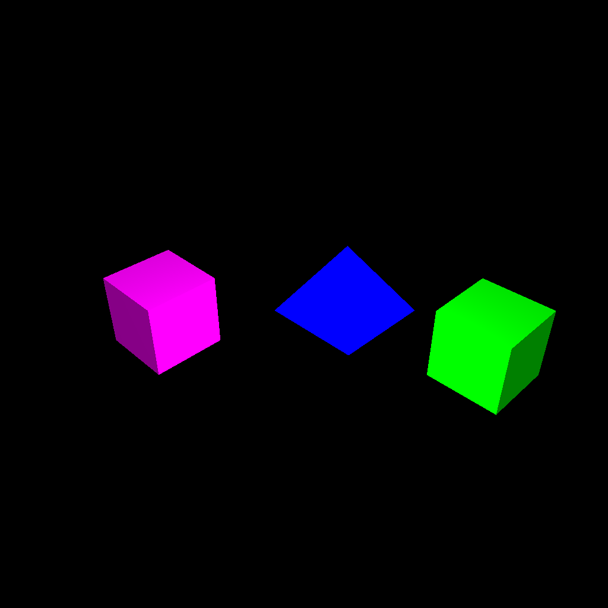
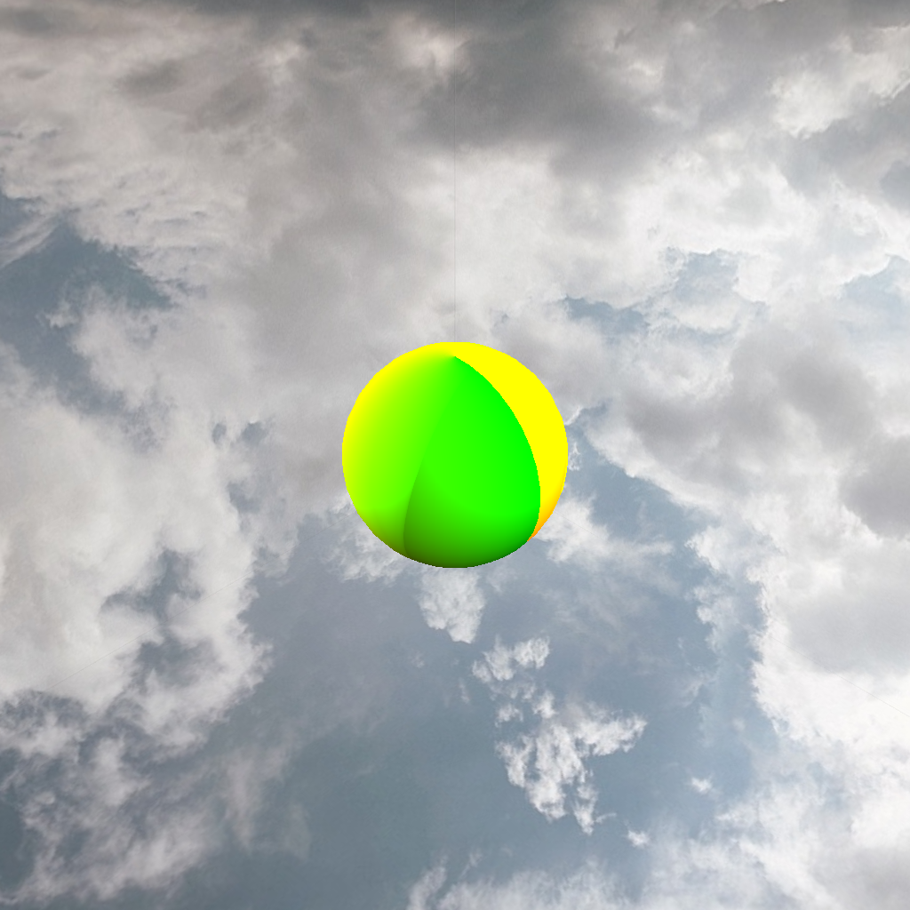

# Lighting and materials

Two cubes and a pyramid with material/light controls, followed by a sphere with two lights, orbiting light position, and a surrounding cubemap.

**Python · GLSL · OpenGL · Blinn–Phong · cubemap textures**



*Exercise 2.1: actual software OpenGL framebuffer capture from the supplied Python code, before GUI overlays.*



*Exercise 2.2: actual software OpenGL framebuffer capture from the supplied Python code, before GUI overlays.*

From the repository root, after completing the [PC setup guide](../../docs/SETUP.md):

```sh
python tools/run.py 2.1
python tools/run.py 2.2
```

The launcher loads the supplied [Shader.py](Shader.py) as the framework shader module. Exercise 2.2 uses the bundled Cloudy cubemap because the original stars images are absent. Its Earth texture remains incorrect, as documented in the original submission. The capture verifies scene rendering, not correct Earth texture mapping.

[Collection overview](../../README.md) · [Detailed run guide](../../docs/SETUP.md)
