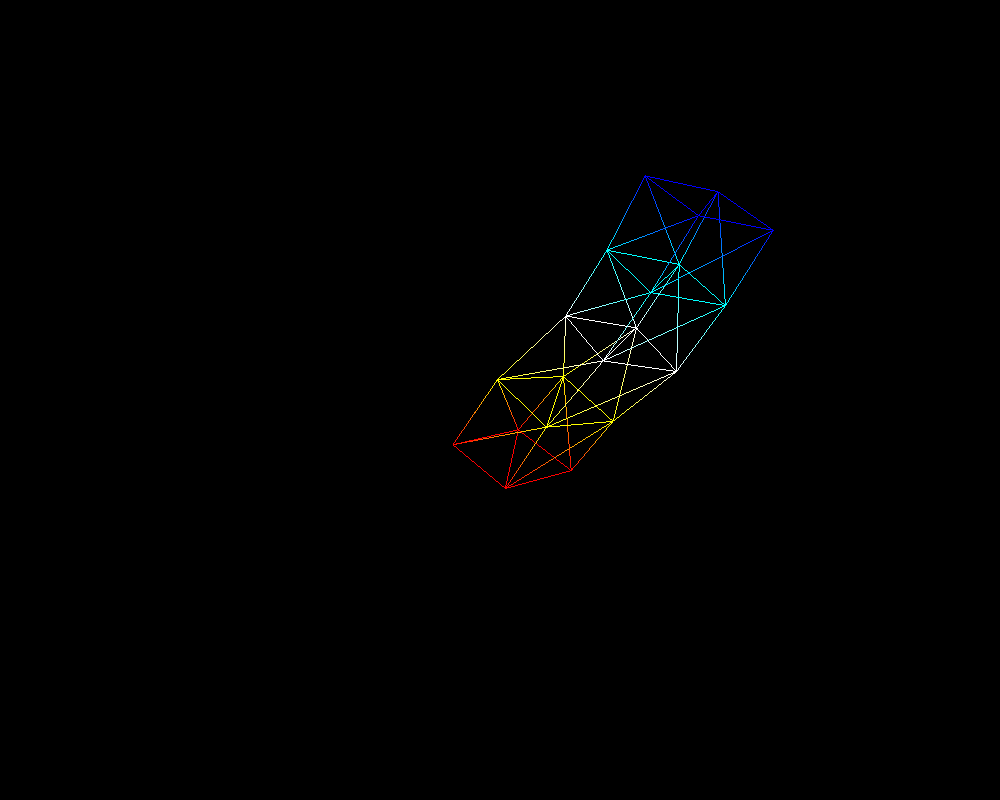

# Joint animation and Maya

Per-vertex weights blend three joint matrices in the vertex shader. Two angle keyframes drive the animation, with manual joint controls when playback is disabled.

**Python · GLSL skinning · NumPy · Maya binary scene**



*Exercise 3.1: actual software OpenGL framebuffer capture from the supplied Python code, before GUI overlays.*

From the repository root, after completing the [PC setup guide](../../docs/SETUP.md):

```sh
python tools/run.py 3.1
```

The [Maya scene](ex32_4845.mb) is preserved byte for byte. The original submission describes nine cubes in an L arrangement with five keyframes. Maya was unavailable, so this scene is not presented as an executed result. A separately linked Unity solar-system project is not included in the archive. See the [Maya and Unity instructions](../../docs/SETUP.md).

[Collection overview](../../README.md) · [Detailed run guide](../../docs/SETUP.md)
